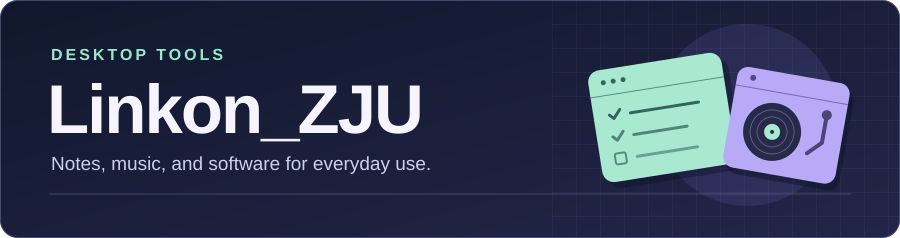

  

<h1 align="center">你好，我是 Linkon</h1>

  <strong>做一些自己每天也想打开的工具。</strong> 
  I build tools I'd want to open every day.

  🎓 浙江大学 · 能源工程学院 · 本科在读 
  Zhejiang University · College of Energy Engineering · Undergraduate Student 
  📮 <a href="mailto:2675647071@qq.com">2675647071@qq.com</a>

  <a href="https://github.com/LKlingkong/NoteDesk">NoteDesk</a>
  · <a href="https://github.com/LKlingkong/ClearPlayer">澄音 CLEAR</a>
  · <a href="https://github.com/LKlingkong?tab=repositories">全部仓库 / Repositories</a>

## 关于我 · About me

我喜欢从日常使用的小细节出发做软件，比如在桌面上记下一件待办、跟着歌词听歌，或者把一段英文读出声。这里记录我做出来的工具和还在尝试的想法。

*I build software around everyday habits: leaving a reminder on the desktop, following lyrics while listening to music, or hearing an English passage read aloud. This is where I share what I've built and what I'm trying next.*

## 精选项目 · Selected projects

| 项目 / Project | 简介 / Overview |
| --- | --- |
| **[NoteDesk](https://github.com/LKlingkong/NoteDesk)** | Windows 桌面便签，支持待办清单、提醒和历史归档。 Windows sticky notes with interactive to-dos, reminders, and an archive. |
| **[澄音 CLEAR](https://github.com/LKlingkong/ClearPlayer)** | Windows 本地音乐播放器，支持同步歌词、黑胶唱片界面和多种外观。 A local music player for Windows with synced lyrics, a vinyl view, and multiple themes. |
| **[MyReader](https://github.com/LKlingkong/MyReader)** | 带朗读功能的英文阅读工具。 An English reading tool with text-to-speech. |

欢迎到各项目的 Issues 分享使用反馈和想法。  
*Feedback and ideas are welcome in each project's Issues.*
